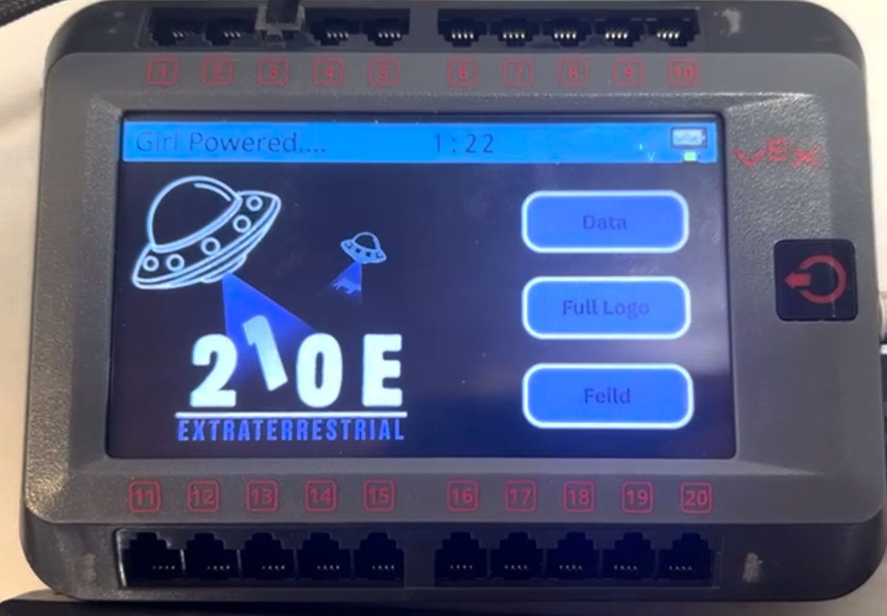
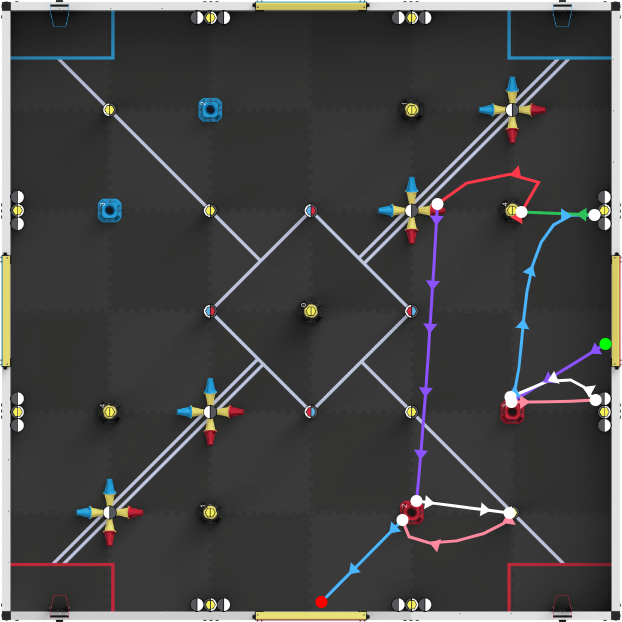

<p align="center">
  
</p>

# YogurtLib

**YogurtLib is a C++ autonomous library for VEX V5 robots on PROS: It has features such as tracking-wheel and multi-IMU odometry, seperate PID controllers you can use, advanced/simple motions you can chain together, and a touchscreen UI with an auton selector for the brain as well as the ability to run motions asynchronously and queue them.**

<!-- Demo gif of robot working at worlds running previus version of YogurtLib -->
<p align="center">
  
</p>

<p align="center">
  <a href="https://github.com/Random-Person123321/YogurtLib/releases/latest"><b>⬇️ Download the newest release</b></a>
  &nbsp;·&nbsp;
  <a href="https://yogurtlib.com/home"><b>🧭 Try the web tools (path planner, data visualizer)</b></a>
</p>

---

## About

This is an effort made to make our own competition library, similar to(& inspired by) LemLib. Where we wanted our own autonomous functions with functionalities that we can control and actually understand by coding it ourselves while still following the princepts of Object Oriented Programming publish it as a template library for others to use.

## Features

- **Odometry from tracking wheels and up to three IMUs.** Pose runs in its own task at 10 ms. Headings from all IMUs are averaged on the unit circle, and a disconnected IMU is skipped, so one bad sensor doesn't throw off the whole run.
- **Motions:** `driveStraight`, `turnToHeading`, `turnToPoint` and `swingToHeading` for the basics, plus `boomerang` (curve into a point and finish at a heading) and `curve` (pure pursuit along your own path points). Every motion returns why it ended: settled, timed out, cancelled, chained, stuck or lost. `driveToPoint` and `driveToPose` are being reworked on top of the new pure pursuit code.
<!-- - **Six motion types:** `driveStraight`, `turnToHeading`, `turnToPoint`, `swingToHeading`, `driveToPoint`, and `driveToPose`. Each returns whether it settled, timed out, or was cancelled. -->
- **Async motions and motion chaining.** Pass `async = true` to keep running other code (intakes, lifts) while the robot drives. Call `waitUntil(n)` to trigger something once the robot has covered `n` inches (or turned `n` degrees) of a motion. Set a `minVolt` above zero and the robot carries its speed into the next motion instead of stopping.
- **Slew rate and static-friction feedforward on every motion.** Slew prevents wheel slip when the robot speeds up, and the kS push stops it stalling short of the target.
- **Automatic tracking-wheel offset tuning.** `tuneOffset()` spins the robot both ways and measures where your tracking wheels actually sit, so you don't have to measure them with a ruler.
- **Brain-screen UI.** Touchscreen pages show live X, Y, heading and each IMU's reading, plus an auton selector and a button to recalibrate the IMUs.
- **Web tools at [yogurtlib.com](https://yogurtlib.com/home).** A Bézier path planner that exports paths in the library's format, a data visualizer for replaying pose logs, and an LVGL image converter for custom brain-screen images.

### In progress
- **Autonomous Simulation** we are planning on making along side our custom pather our own digital autonomous simulation that can run in your browser using YogurtLib's API, it would also provide a demo/tuning groud for the upcoming MCL(see below)
- **Monte Carlo Localization** using the four distance sensors and a beam sensor model to correct odometry drift against the field walls. It's being prototyped in a browser simulator first, then ported to the brain.

## Quick start

You'll need the [PROS CLI](https://pros.cs.purdue.edu/v5/getting-started/index.html) and an existing PROS 4 project. Download `yogurtlib@1.0.0.zip` from the [latest release](https://github.com/Random-Person123321/YogurtLib/releases/latest) (and make sure it's in the root fo your PROS project folder ie. drag it into the folder of your project name), then run these from your project folder:

```bash
pros c fetch yogurtlib@1.0.0.zip
pros c apply yogurtlib
```

Include it in `src/main.cpp`, describe your robot, and drive:

```cpp
#include "main.h"
#include "yogurtlib/api.hpp"

// Drive motors (negative port = reversed)
pros::MotorGroup leftMotors({-19, 20});
pros::MotorGroup rightMotors({-18, 17});
yogurt::DriveMotors motors(&leftMotors, &rightMotors, 2.75);   // wheel diameter (in)

// Odometry: a vertical and a horizontal tracking wheel, plus 1-3 IMUs
pros::Rotation vertical(4), horizontal(5);
pros::Imu imu1(1), imu2(2), imu3(3);
std::vector<pros::Imu*> imus = {&imu1, &imu2, &imu3};

yogurt::OdomSensors odom(&vertical, 2.0, 0.25,      // vertical wheel: diameter, offset (in)
                         &horizontal, 2.0, -2.7,    // horizontal wheel: diameter, offset (in)
                         imus,
                         nullptr, nullptr, nullptr, nullptr,  // distance sensors (optional)
                         0.0, 0.0, 0.0, 0.0);

//                                  kP     kI   kD    maxI  errTol velTol settleMs
yogurt::ControllerSettings lateral(600.0, 0.0, 0.0,  3.0,  0.1,   0.5,   1000);
yogurt::ControllerSettings turn   (120.0, 0.0, 15.0, 2.0,  0.75,  8.0,   200);
yogurt::ControllerSettings swing  (200.0, 0.0, 16.0, 3.0,  0.75,  8.0,   200);

yogurt::Drivetrain drivetrain(motors, odom, lateral, turn, swing);

void initialize() {
    drivetrain.calibrate(yogurt::Pose(0, 0, 90));   // resets IMUs, starts odometry
}

void autonomous() {
    drivetrain.driveStraight(24, 2000);           // 24 in forward
    drivetrain.turnToHeading(0, 1000);            // face east
    drivetrain.boomerang(48, 24, 90, 2500);       // arc into (48, 24), ending facing north
}
```

The example gains are from our own robot. You'll need to tune them for yours.

### Running it

1. Upload your project to the brain with `pros mu`.
2. On the brain's screen, open the auton selector and pick your autonomous.
3. Start it from a competition switch or field control, or call `autonomous()` from `opcontrol()` to test it without one.

## Screenshots

<table align="center">
  <tr>
    <td align="center">
      <br/>
      <sub>The brain UI home screen, with pages for the field / auton selector, the team logo, and live sensor data.</sub>
    </td>
    <td align="center">
      <br/>
      <sub>The <a href="https://yogurtlib.com/tools/custom-pather.html">Pather</a> on yogurtlib.com: draw a curve and export its points for <code>curve()</code>.</sub>
    </td>
  </tr>
</table>

## Conventions

- **Angles follow the unit circle:** 0° = east, 90° = north, counterclockwise is positive. Autons assume the robot starts at 90°, facing away from the alliance wall.
- **Distances are in inches. Motion output is in millivolts**, capped at `maxVoltage` (12000 by default).
- **Slew is measured in mV per 10 ms loop.** The default is 600.

## How it works

### Voltage control
We don't use the motors' built-in velocity PID (`move_velocity`). It reacts slowly and changes with load. Every motion sends voltage directly and uses odometry to check itself.

`curve()` takes speed on a 0–127 scale (negative for reverse), like PROS's `move()`, where 127 is the fastest your robot actually drives. **Every other function uses millivolts**, so `maxVolt` and `minVolt` are out of `12000`.

### Odometry
A background task updates the position every 10 ms. X and Y come from the tracking wheels. Heading comes only from the IMUs (up to three, averaged together), not the distance sensors. If an IMU disconnects, it's skipped. When the MCL functionality is added, will only correct X and Y to stop error building up over time.

### Every motion works the same way
- Settings go in a `Params` struct. `-1` means "use the default."
- Every motion returns why it ended (settled, timed out, cancelled, etc.).
- "Settled" means the error is small, the robot has stopped moving, and it stays that way for `settleMs`.
- Change any default with `drivetrain.attribute = value` (use `{}` for structs).

### Chaining, async and `waitUntil`
- **Chaining:** set `minVolt` (or `minSpeed` for `curve()`) above 0 and the robot keeps its speed into the next motion.
- **Async:** `async = true` runs the motion in the background. A second async motion waits its turn.
- **`waitUntil(n)`:** runs your next line once the robot is `n` inches (or degrees) into the motion.

### Pure pursuit (`curve()`)
Based on Team 1712 Dawgma's *Implementation of the Adaptive Pure Pursuit Controller*.
- **Plans speed ahead of time.** It slows for tight curves (`turnK`) and starts braking before the end (`decelDist`), so it slows *before* a corner, not during it.
- **No smoothing step.** Our [Pather](https://yogurtlib.com/tools/custom-pather.html) already gives smooth, evenly spaced points. We kept point injection for the driveTo functions.
- **Real wheel speed.** Speed is measured from encoder ticks. Voltage comes from the target speed (kV, kA, kS) plus a small correction (kP). If `move(40)` measures 38, tune kV to match.
- **Stops if lost.** If the robot ends up farther than `lostDist` from the path, it stops.

### Boomerang
Ends at a point facing a set direction. The robot chases a "carrot" point behind the target (`lead` sets how far), so it curves in already lined up, then drives straight in at the end.

### One `Drivetrain` object
Everything lives in one class instead of separate global functions: the hardware, the PID controllers, the position and the odometry task. Defaults are fields you can change after setup. Optional parts like the UI hook in through `onCalibrated` callbacks.

## Building from source

Requirements: the PROS CLI with kernel **4.2.2** and the ARM toolchain that comes with it, plus a V5 brain for testing.

```bash
git clone https://github.com/Random-Person123321/YogurtLib.git
cd YogurtLib
pros make template      # builds yogurtlib@1.0.0.zip, the same file shipped in releases
```

`src/main.cpp` is excluded from the template, so you can use it as a test program. Run `pros mu` to upload it to a brain.

## Credits

- Built by Eric (team **210E**).
- [PROS](https://pros.cs.purdue.edu/), the kernel and toolchain YogurtLib runs on.
- [LVGL](https://lvgl.io/), which powers the brain-screen UI.
- [LemLib](https://github.com/LemLib/LemLib), a big inspiration for the API style (0–127 speeds, motion chaining).
- Team 1712 Dawgma's *Implementation of the Adaptive Pure Pursuit Controller*, the basis for the path follower.
